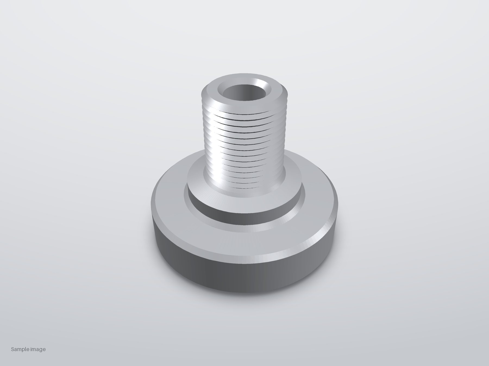
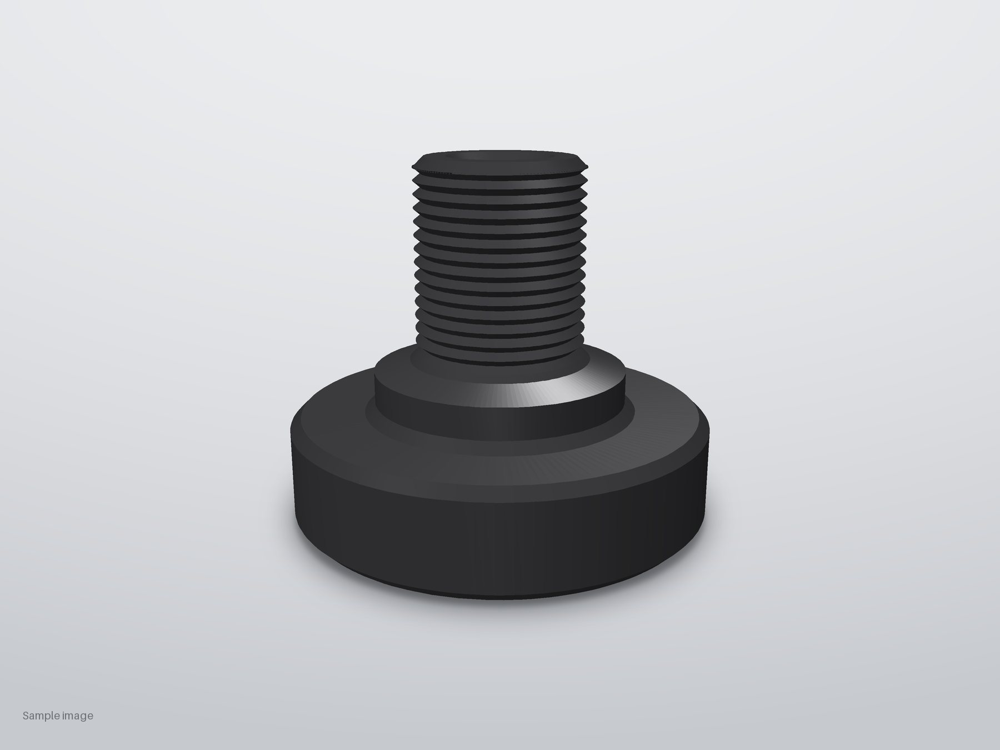
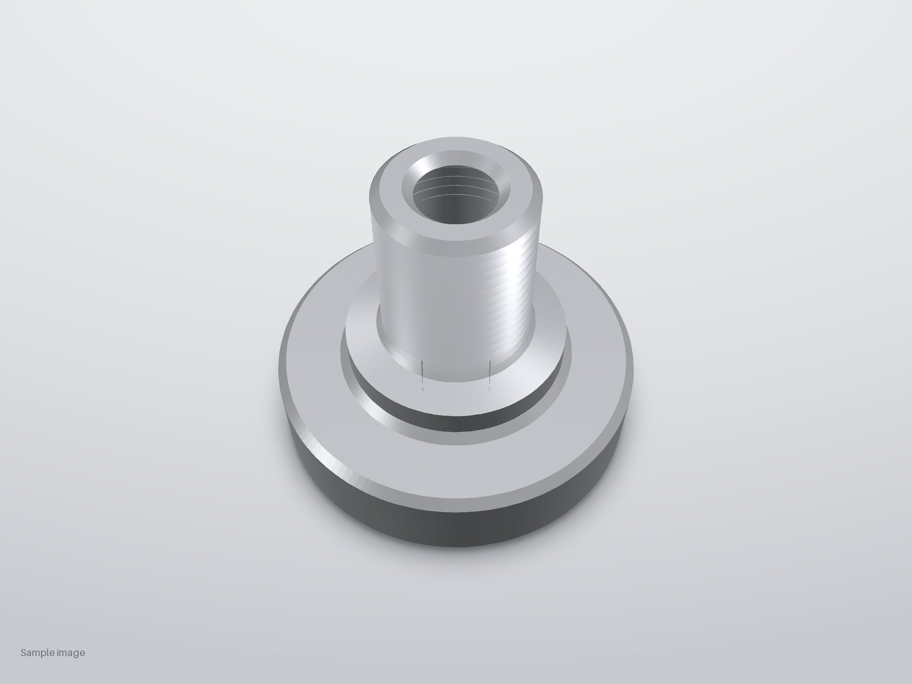
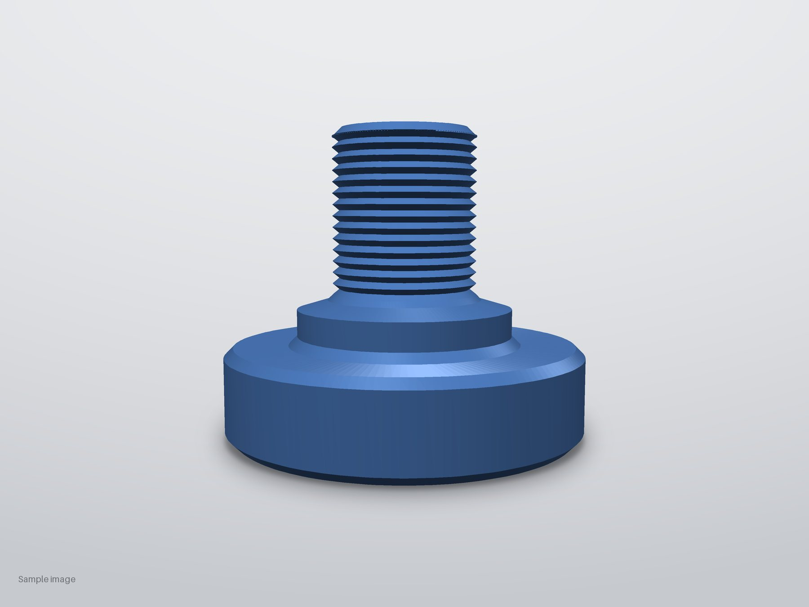

This is sample content. It shows a medium-length write-up with a gallery and a 3D
model listed in the project's settings instead of in the text.

## What it does

The lab tests small sheet-metal brackets for 10⁶ cycles at 15 Hz. The old setup
clamped each bracket with a vise and shims, took 40 minutes to align, and the shims
fretted loose partway through long runs.

The new fixture is a steel base with a locating pin and two clamp bars. A turned load
adapter threads into the load cell on one side and pins to the bracket on the other,
so the load path stays on the actuator's axis.

## Parts

<Gallery>

</Gallery>

## Results so far

- Alignment is now set by the locating pin, so setup takes 12 minutes.
- Three brackets have run to 10⁶ cycles with no clamp slip.
- [[TODO: Add the measured misalignment once the dial-indicator check is done.]]
