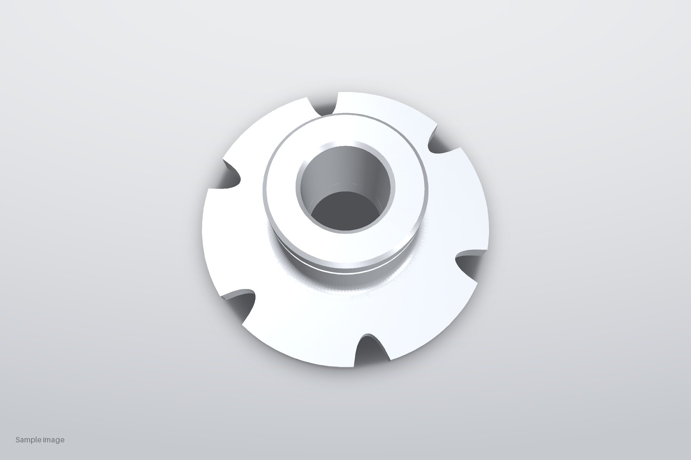
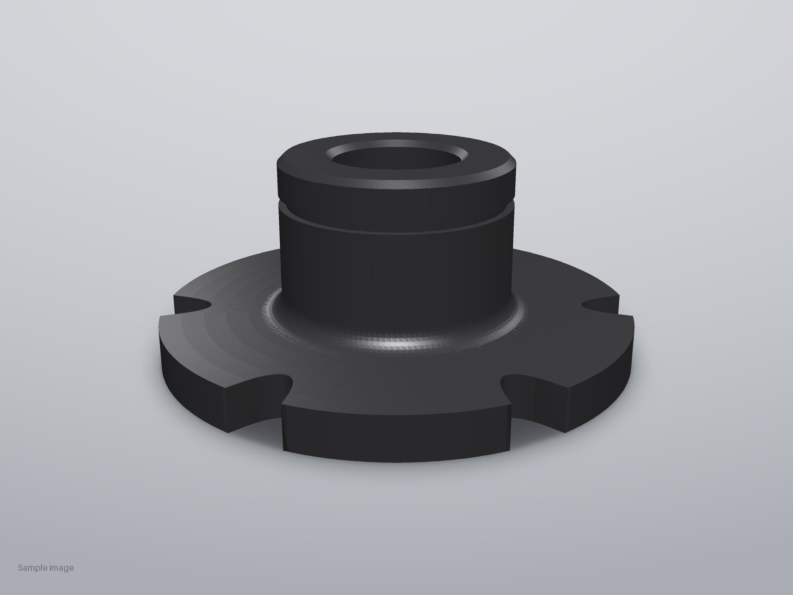
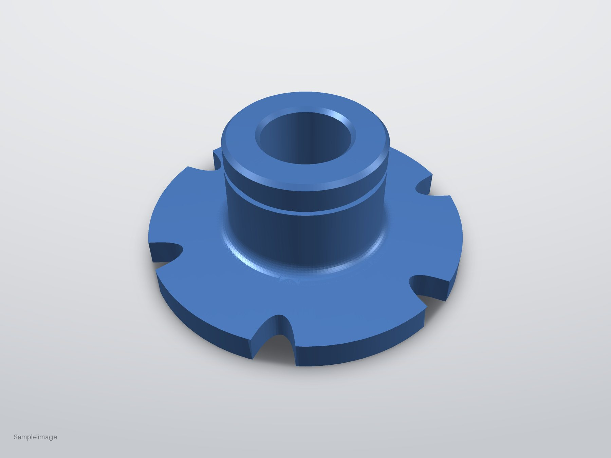
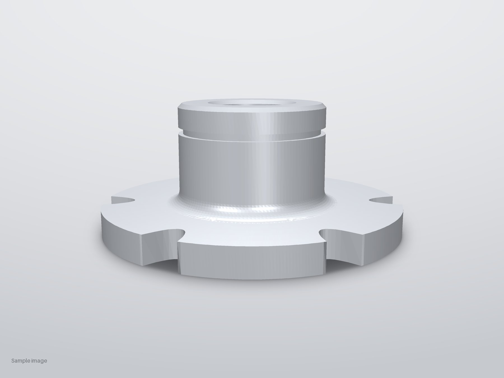

This is sample content. It shows every building block a project page can use, so you
can copy what you need. Replace it with your own write-up, or delete the project folder.

## The problem

The output hub couples the final gear of the drivetrain to the wheel. The original
part was a 6061 aluminum block machined to a round, with a flat 8 mm flange and a
plain bore. It worked, but it was the heaviest single machined part on the robot, and
it cracked at the flange-to-boss corner after a season of hard impacts.

The goals for the redesign were:

- Cut mass by at least 15%.
- Keep the six-slot bolt pattern so nothing else in the gearbox changes.
- Survive twice the worst load we measured in competition without yielding.

[[TODO: Replace with your own problem statement. Say who needed what, and why the old design wasn't good enough.]]

<Figure caption="Top view. The six scallops in the flange clear the bolt heads and remove material where the flange carries little load.">

</Figure>

## Loads and constraints

We put a strain gauge on the old hub and logged three competition matches. The worst
event was a wheel strike against a wall at full speed.

<SpecTable caption="Design loads, from match data. Proof load is twice the peak.">

| Quantity | Value | Unit |
|---|---|---|
| Peak torque, measured | 38 | N·m |
| Proof torque, design target | 76 | N·m |
| Peak radial load at wheel | 610 | N |
| Bore diameter | 24.0 | mm |
| Flange outer diameter | 90.0 | mm |
| Mass, original | 412 | g |
| Mass, final | 321 | g |

</SpecTable>

<KeyDecision title="Where to take material out">

### Options

1. **Thin the flange** from 8 mm to 6 mm everywhere.
2. **Pocket the flange** with blind pockets between the bolt slots.
3. **Scallop the flange edge** between the bolt slots and add a fillet at the boss.

### Constraints

- The shop's mill could hold ±0.05 mm on the slots, but deep pockets meant a long
  3 mm end mill and slow passes.
- The crack in the old part started at the sharp flange-to-boss corner, so that corner
  had to get stronger, not weaker.

### Analysis

A linear static FEA of each option at proof torque gave these peak von Mises
stresses at the flange-to-boss corner:

| Option | Peak stress | Mass |
|---|---|---|
| Thin flange | 241 MPa | 356 g |
| Pockets | 198 MPa | 338 g |
| Scallops + 4 mm fillet | 162 MPa | 321 g |

Scallops removed the most mass because they take material out where the flange does
the least work. The fillet cut the corner stress by spreading the load over a larger
area. 6061-T6 yields at about 276 MPa, so the scallop design has a safety factor of 1.7
at proof load.

### Outcome

We chose scallops with a 4 mm fillet. It was the lightest option, the easiest to
machine (one profile pass), and the only one that lowered stress at the corner that
had cracked.

</KeyDecision>

## Revisions

Three revisions, all machined in the student shop. Revision A was black-oxide steel
to check fit before cutting aluminum.

<Gallery>

</Gallery>

<Callout type="note">
Rev B was anodized before we noticed the snap-ring groove was 0.2 mm shallow. Check
groove depth before sending parts out for finishing.
</Callout>

## Testing

We clamped the hub's bore on a splined shaft and applied torque with a lever arm and
calibrated weights, in steps of 10 N·m up to 76 N·m. A dial indicator on the flange
edge measured permanent set after each step.

- No measurable set (under 0.01 mm) at any step.
- Rev C has run a full season with no cracks on inspection.

<Model3D file="./output-hub.glb" title="Output hub, Rev C" caption="Sample model generated for this template." />

<Callout type="todo">
Add a photo of your own test setup and a plot of load against deflection.
</Callout>

## What I'd do differently

I would have instrumented the old part earlier. Two weeks went into designing for a
load guess that turned out to be 40% low.
